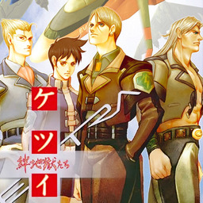

<h1 align=center>Ketsui: Kizuna Jigoku Tachi: Nintendo Switch port</h1>

<b>ketsui-nx 1.0.0</b> · <a href="https://chanseyisthebest.github.io/ketsui-nx-installer/">web installer</a> · <a href="https://github.com/ChanseyIsTheBest/ketsui-nx/releases/tag/v1.0.0">release</a>

An unofficial native port of the Xbox 360 version of **Ketsui: Kizuna Jigoku Tachi Extra** (CAVE, 5pb.), made by static
recompilation with [ReXGlue](https://github.com/rexglue/rexglue-sdk) and drawn by
[reNut](https://github.com/masterspike52/reNut)'s renderer on deko3d. No emulator. Built on
[guwange-nx](https://github.com/ChanseyIsTheBest/guwange-nx) and [futari-nx](https://github.com/ChanseyIsTheBest/futari-nx).

This repository contains no game files. You need your own copy of the game, dumped from your own disc: the Japanese
Xbox 360 disc **Ketsui Kizuna Jigoku Tachi Extra** (title `465607D1`), as a disc image (`.iso`) or extracted folder.

## Playing it on the Switch

1. Open the web installer: **https://chanseyisthebest.github.io/ketsui-nx-installer/**
2. Give it your disc image or extracted folder and press **Create ketsui-nx.zip**. It all runs in your browser.
3. Extract `ketsui-nx.zip` into `sdmc:/switch/`.
4. Start it with a game override (hold **R** while starting an installed title) or a forwarder.

Features:

- Native Switch renderer (reNut's, on deko3d); the game runs one frame per vblank, as on the console.
- Lower input lag: the controllers are read as late in the frame as is safe.
- Saves as on the console (in `ketsui/` next to the NRO).
- Two players: every controller is its own player; single Joy-Cons held sideways; **L + R + ZR** opens the controller
  screen.
- Face buttons by position as on the Xbox 360 pad (Switch B = Xbox A, A = B, Y = X, X = Y); `input_xbox_layout = false`
  for by letter. Per-player remapping in `ketsui.toml` (`[input_p1]`, `[input_p2]`).

Your options are in `ketsui.toml` next to the NRO; delete it and the game writes the default one again.

Warnings:

- Album applet mode does not give the game enough memory. A forwarder must be set to a **39-bit address space**.
- The first time you play it can stutter for a moment in new places while shaders compile; later sessions start
  smoothly.

## Building

Windows, LLVM clang 20 and the VS 2022 Build Tools for the PC build; devkitA64, libnx and deko3d from
[devkitPro](https://devkitpro.org) for the Switch; Python; and your own copy of the game for the code generator and the
shaders. Steps in [docs/building.md](docs/building.md). More: [docs/ketsui-notes.md](docs/ketsui-notes.md),
[docs/futari-notes.md](docs/futari-notes.md), [docs/research/](docs/research/).

## Credits and license

- **CAVE** and **5pb.**: Ketsui and its Xbox 360 version. This is an unofficial fan-made port with no affiliation.
- **ChanseyIsTheBest**: this port, and guwange-nx and futari-nx, which it is built on.
- **[Tom Clay](https://github.com/rexglue/rexglue-sdk)**: the ReXGlue SDK, built on the work of the
  **[Xenia](https://xenia.jp)** team (xenia-edge's XamContentResolve semantics for the saves).
- **[StevensND](https://github.com/StevensND/nfsmw-nx)**: nfsmw-nx, the SDK's Switch layer and much of the method.
- **[nebadasSwifty](https://github.com/nebadasSwifty/masseffect-nx)**: masseffect-nx, the native renderer futari-nx's
  renderer work grew from.
- **[hedge-dev](https://github.com/hedge-dev/XenosRecomp)**: XenosRecomp, the Xenos shader translator.
- **reNut and [masterspike52](https://github.com/masterspike52/reNut)**: reNut's Direct3D-level renderer, reused with
  its author's permission; and banjo-nx (Banjo-Kazooie: Nuts & Bolts), whose adaptation of it, plume deko3d back end,
  shader passes and tools this port takes.
- **[plume](https://github.com/renderbag/plume)** (from UnleashedRecomp), **[deko3d](https://github.com/devkitPro/deko3d)**
  and **[uam](https://github.com/devkitPro/uam)** by fincs, with SwitchWakerHD's uam patches.
- **[devkitPro](https://devkitpro.org) and [switchbrew](https://github.com/switchbrew/libnx)**: devkitA64 and libnx.
- The sibling ports ([Sonic Adventure 2](https://github.com/ChanseyIsTheBest/sa2-nx), Banjo-Kazooie: Nuts & Bolts,
  Peggle 2, Peggle, Bejeweled 3, Feeding Frenzy), which share their fixes.
- **[KhronosGroup](https://github.com/KhronosGroup/SPIRV-Cross)**: SPIRV-Cross.
- The other libraries in [THIRD_PARTY_NOTICES.md](THIRD_PARTY_NOTICES.md).

No affiliation with CAVE, 5pb., Microsoft or Nintendo. "Ketsui" is a trademark of CAVE. This repository contains no
assets or code from the original game; everything made from your copy (`assets/`, `app/generated/`, the shaders) is
made on your own computer. Running homebrew needs custom firmware, which violates Nintendo's ToS and can get a console
banned.

GPL-3.0 (see [LICENSE](LICENSE)); the SDK keeps its BSD-3-Clause license (see
[THIRD_PARTY_NOTICES.md](THIRD_PARTY_NOTICES.md)).
