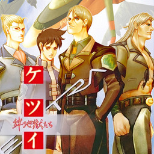

<div align=center>



</div>
<h1 align=center>Ketsui: Kizuna Jigoku Tachi — Nintendo Switch port</h1>

A native Nintendo Switch port of the Xbox 360 version of **Ketsui: Kizuna Jigoku Tachi Extra** (CAVE, 5pb.).

It's not an emulator. The PowerPC code of the game's `default.xex` is statically recompiled to C++ with
[ReXGlue](https://github.com/rexglue/rexglue-sdk) and compiled for the Switch, and the game's Direct3D calls are drawn
directly on the Switch GPU's own API, deko3d, by [reNut](https://github.com/masterspike52/reNut)'s Direct3D-level
renderer. The port is built on [guwange-nx](https://github.com/ChanseyIsTheBest/guwange-nx) and
[futari-nx](https://github.com/ChanseyIsTheBest/futari-nx), the Guwange and Mushihimesama Futari ports.

> [!NOTE]
> You need your own copy of the game, dumped from your own disc: the Japanese Xbox 360 disc **Ketsui Kizuna Jigoku
> Tachi Extra** (title `465607D1`), as a disc image (`.iso`) or a folder you extracted it into.

## How to install

1. Open the installer page: **https://chanseyisthebest.github.io/ketsui-nx-installer/**
2. Choose the game (its disc image, or the folder you extracted it into), then press **Create ketsui-nx.zip**.
   Everything runs in your browser and the game files never leave your computer: the page checks your copy, downloads
   the build and makes the shaders from your game's own executable.
3. Extract the downloaded `ketsui-nx.zip` into `sdmc:/switch/`.

Your `ketsui-nx` folder should look like this:

```text
/switch/ketsui-nx/
  ketsui.nro
  LICENSES.txt
  ketsui.toml               (your settings; written at the first start when it is missing)
  deko3d_glsl.bin           (the game's shaders, made from your copy)
  game_root/                (the game's files: default.xex, Data/, ...)
```

The game adds `deko3d_shaders.bin` and `pipeline_list.bin` there as you play (the shaders compiled for the Switch
GPU, and the list of what it drew, so later sessions prepare it ahead), and keeps its save in `ketsui/`.

Launch it with a game override (hold **R** while starting an installed title) or a forwarder. Album applet mode does
not give the game enough memory. If you use a forwarder, set it to a **39-bit address space**.

To build everything yourself, see [docs/building.md](docs/building.md).

> [!CAUTION]
> **The first time you play**, the game compiles its shaders for the Switch GPU as it meets them, so **IT CAN STUTTER
> for a moment** in new places. They are saved next to the NRO (`deko3d_shaders.bin`) and later sessions start
> smoothly.

## Controls

By default the face buttons work **by position, as on the Xbox 360 pad** the game was made for: the bottom button is
the Xbox's A, the right one is the Xbox's B, and so on.

<div align="center">

| Switch | Xbox 360 |
| --- | --- |
| B (bottom) | A |
| A (right) | B |
| Y (left) | X |
| X (top) | Y |
| ZR / ZL | RT / LT |
| R / L | RB / LB |
| + | Start |
| − | Back |
| Sticks / D-pad | Sticks / D-pad |

</div>

To use the buttons by letter instead (the Switch's A acts as A), set `input_xbox_layout = false` in `ketsui.toml`.

**Two players:** every controller is its own player, in the order they connect. The console in handheld mode counts
as one, so handheld + a Pro Controller makes players 1 and 2. Single Joy-Cons are held sideways, one per player.
**L + R + ZR** opens the system's controller screen to connect, reorder, or split a Joy-Con pair.

**Remapping:** each player has a button map in `ketsui.toml` (`[input_p1]` and `[input_p2]`).

## Settings

`ketsui.toml`, next to the NRO, holds only your options. Everything else is built into the NRO.

<div align="center">

| Setting | What it does |
| --- | --- |
| `input_xbox_layout` | Face buttons by position (`true`, default) or by letter (`false`) |
| `input_joycon_sideways` | Single Joy-Cons held sideways, one per player (`true`, default) |
| `[input_p1]`, `[input_p2]` | Each player's buttons: for every Xbox button, the Switch buttons that press it, e.g. `a = "B, ZR"` |

</div>

If you delete `ketsui.toml`, the game writes the default one again at the next start.

## How it works

- **The game's code is translated, not emulated.** [ReXGlue](https://github.com/rexglue/rexglue-sdk) translates every
  function of `default.xex` to C++, which is then compiled for the Switch, with the code generation that reproduces
  the Xbox 360's vector unit exactly (its fused multiply-adds, minimum and maximum, estimates, NaNs). ReXGlue also
  gives the game what it expects from an Xbox 360: its system, files, saves, audio and controllers.
- **Saves as on the console.** Ketsui checks its save package's size before it loads it (an Xbox 360 STFS package of
  61,440 bytes); the SDK answers with the size the console's package of the same files would have.
- **A Direct3D-level renderer on deko3d.** The game's Direct3D calls are replaced by
  [reNut](https://github.com/masterspike52/reNut)'s renderer (as banjo-nx, futari-nx and guwange-nx adapted it), which
  draws them with [plume](https://github.com/renderbag/plume) on [deko3d](https://github.com/devkitPro/deko3d), the
  Switch GPU's own API: no GPU command stream is written or parsed and no EDRAM is modelled. As on the console, a frame
  ends at the vertical blank, so the game runs one frame per vblank.
- **Lower input lag**: the game reads the controllers as late in its frame as it safely can, and its 60 Hz follows the
  screen's own refresh.

Every optimisation has its own setting, and two master switches turn the CPU and the other ones off.

## Documentation

<div align="center">

| Document | What it explains |
| --- | --- |
| [docs/building.md](docs/building.md) | How to build the PC test build, the NRO and the shaders |
| [docs/ketsui-notes.md](docs/ketsui-notes.md) | Ketsui's notes: saves, its Direct3D, the renderer's pacing, late input, shaders |
| [docs/futari-notes.md](docs/futari-notes.md) | futari-nx's notes, which this port shares: its renderer, optimisations and how they were checked |
| [docs/research/](docs/research/) | Research notes and comparisons with the sibling ports |

</div>

## Build

Windows, LLVM clang 20 and the VS 2022 Build Tools for the PC build; devkitA64, libnx and deko3d from
[devkitPro](https://devkitpro.org) for the Switch; Python; and your own copy of the game for the code generator and
the shaders. The whole process is in [docs/building.md](docs/building.md).

## Credits

- **CAVE** and **5pb.** — creators of Ketsui and its Xbox 360 version. This is an unofficial, fan-made port with no
  affiliation.
- **ChanseyIsTheBest** — this port, guwange-nx and futari-nx, the ports it is built on.
- **[Tom Clay](https://github.com/rexglue/rexglue-sdk)** — the ReXGlue SDK, built on the work of the
  **[Xenia](https://xenia.jp)** team (xenia-edge's XamContentResolve semantics for the saves).
- **[StevensND](https://github.com/StevensND/nfsmw-nx)** — nfsmw-nx: the Switch layer of the SDK and much of the
  method.
- **[nebadasSwifty](https://github.com/nebadasSwifty/masseffect-nx)** — masseffect-nx: the native renderer futari-nx's
  renderer work grew from.
- **[hedge-dev](https://github.com/hedge-dev/XenosRecomp)** — XenosRecomp, the Xenos shader translator.
- **reNut and [masterspike52](https://github.com/masterspike52/reNut)** — reNut's Direct3D-level renderer, which the
  deko3d renderer is (reused with its author's permission); and Banjo-Kazooie: Nuts & Bolts' port (banjo-nx), whose
  adaptation of it, plume deko3d back end, shader passes and tools this port takes.
- **[plume](https://github.com/renderbag/plume)** (from UnleashedRecomp), **[deko3d](https://github.com/devkitPro/deko3d)**
  and **[uam](https://github.com/devkitPro/uam)** by fincs, with SwitchWakerHD's uam patches.
- **[devkitPro](https://devkitpro.org) and [switchbrew](https://github.com/switchbrew/libnx)** — devkitA64 and libnx.
- The sibling ports ([Sonic Adventure 2](https://github.com/ChanseyIsTheBest/sa2-nx), Banjo-Kazooie: Nuts & Bolts,
  Peggle 2, Peggle, Bejeweled 3, Feeding Frenzy), which share their fixes with this one.
- **[KhronosGroup](https://github.com/KhronosGroup/SPIRV-Cross)** — SPIRV-Cross.
- The other libraries listed in [THIRD_PARTY_NOTICES.md](THIRD_PARTY_NOTICES.md).

## Legal

No affiliation with CAVE, 5pb., Microsoft or Nintendo. "Ketsui" is a trademark of CAVE. This repository contains no
assets or program code from the original game. Users must provide their own legally obtained copy, and everything made
from it (`assets/`, `app/generated/`, the shaders) is made on their own computer. Running homebrew requires custom
firmware, which violates Nintendo's ToS and can get a console banned — your call.

Source code is provided under the GPL-3.0 License (see [LICENSE](LICENSE)), like the ports it builds on. The SDK keeps
its BSD-3-Clause license (see [THIRD_PARTY_NOTICES.md](THIRD_PARTY_NOTICES.md)).
